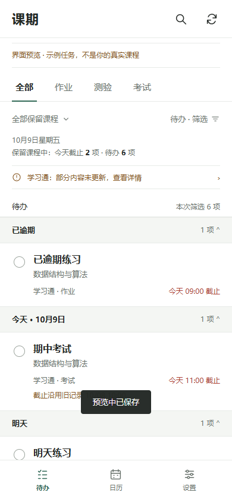
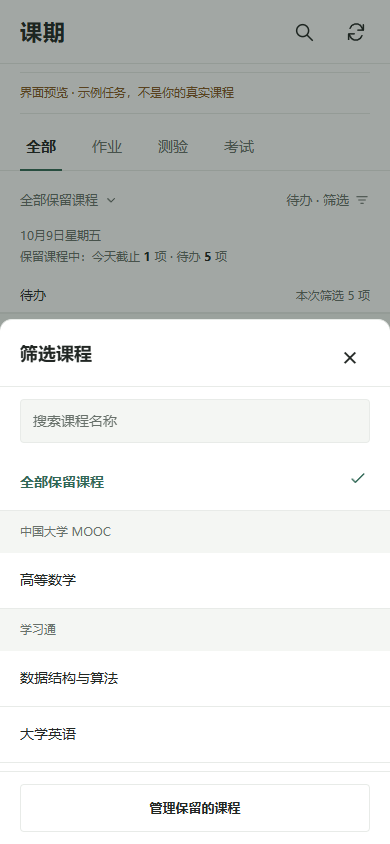
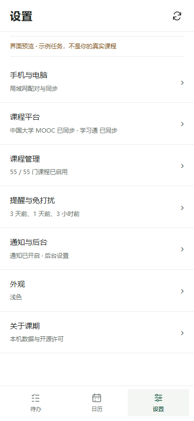

# 课期 · Keqi

在安卓手机和 Windows 电脑上集中查看中国大学 MOOC 与学习通的作业、测验和考试，并接收本地截止提醒。

无需自建服务器或付费推送，电脑关机后手机仍可运行。任务与设置保存在本机，登录由平台官方页面完成。

[下载安装包](https://github.com/xxszyh/keqi/releases/latest) · [使用说明](docs/USAGE.md) · [编译源码](docs/BUILDING.md) · [参与贡献](CONTRIBUTING.md) · [更新记录](CHANGELOG.md)

## 界面

以下为明确标注的示例数据，不是用户真实课程。

| 待办列表 | 课程筛选 | 设置 |
| --- | --- | --- |
|  |  |  |

## 最新开发进度

当前源码版本为 **安卓 0.11.1 / Windows 0.11.2**。新增 Windows 电脑版与局域网同步、手动待办、子任务、备注、优先级、标签、批量编辑和重复任务。电脑附带运行环境，关闭窗口后驻留托盘；两端分别登录平台并独立提醒。

最新修复涵盖安卓启动卡顿，以及桌面 MOOC 登录跳转、未完成资源拖住连接和大页面打断任务读取。Windows 0.11.2 已在实际安装环境重复验证 MOOC 连接与完整读取；验证范围和仍需核对的边界见下方记录。源码及本地安装包已生成，GitHub 当前正式 Release 仍为 0.10.0。

[手机与电脑使用说明](docs/DESKTOP_USAGE.md) · [桌面构建](desktop/README.md) · [功能范围](docs/DESKTOP_REQUIREMENTS.md) · [桌面验证记录](docs/DESKTOP_VERIFICATION.md) · [安卓验证记录](mobile/验证记录.md)

## 功能

- 学习通与中国大学 MOOC/SPOC 独立登录和同步，读取可识别的作业、测验、考试及互评。
- 日期分组待办、搜索、课程/平台/类型/状态筛选，以及截止日历。
- 课程按平台收起，可批量选择、持久移出、撤销和重新导入；选课同时作用于列表、日历、统计和提醒。
- 默认提前 3 天、1 天、3 小时提醒，支持自定义、免打扰、本地已处理、补充日期与稍后提醒。
- 区分本轮读取与旧缓存，详情失败时保留旧截止并标明；支持深色模式。

当前正式 Release 的安卓安装版本为 **0.10.0**。下载 [官方 APK](https://github.com/xxszyh/keqi/releases/download/v0.10.0/keqi-android-v0.10.0.apk)，安卓 8.0 及以上可安装。同签名更新可直接覆盖，卸载会删除本机数据。最新开发版可按照编译说明从源码构建。

首次使用：在「设置 → 通知与后台」开启通知，在「设置 → 课程平台」完成官方登录并连接，在「课程管理」保留需要的课程。更多操作见 [使用说明](docs/USAGE.md)。

## 开发

当前提供 Windows x64 的便携构建流程，使用 Java 8 语法、JDK 17、Android SDK 35、Python 3.10+。界面是 APK 内置 HTML/CSS/JS，浏览器预览带示例标识；不需要前端打包工具。

```powershell
git clone https://github.com/xxszyh/keqi.git
cd keqi
python -m venv .venv
.\.venv\Scripts\python.exe -m pip install -r requirements.txt
$env:KEQI_TOOL_CACHE = 'C:\KeqiTools'
.\.venv\Scripts\python.exe mobile\bootstrap_tools.py
.\.venv\Scripts\python.exe scripts\check_repo.py
.\.venv\Scripts\python.exe mobile\run_checks.py --domain-only
.\.venv\Scripts\python.exe mobile\build.py
```

产物为 `mobile/课期-安卓.apk`。已有 Android SDK 可使用 `configure_tools.py`，详见 [编译说明](docs/BUILDING.md)。自行构建及 CI 使用开发者自己的调试签名，不能直接覆盖官方 APK。

| 文档 | 内容 |
| --- | --- |
| [架构](docs/ARCHITECTURE.md) | 项目目录、同步/数据/提醒模块与关键边界 |
| [测试](docs/TESTING.md) | JVM 与 Edge 检查、自动构建、实机验证范围 |
| [贡献指南](CONTRIBUTING.md) | 匿名复现、代码约定和 PR 流程 |
| [发布流程](docs/RELEASING.md) | 版本、私有签名、安装包和校验 |
| [安全报告](SECURITY.md) | 私密漏洞报告与敏感数据处理 |
| [整理检查记录](docs/OPEN_SOURCE_AUDIT.md) | 历史扫描、依赖、干净副本与自动检查结果 |

## 数据与适用范围

项目是独立的社区工具，与学习通、超星、中国大学 MOOC 或学校没有隶属关系。只读取用户已连接账号可访问的任务，不自动作答、提交、开始考试或处理验证码。平台网页字段和内部 RPC 变化可能导致读取不完整；学校单独考试系统、班群公告和列表外任务不保证覆盖。

任务、设置和提醒保存在 Android 私有 SQLite；WebView 保存官方会话 Cookie，另有 Keystore AES-GCM 会话备份，系统备份关闭。平台登录页面自身可能请求平台服务。课期不设自建账号服务器。

后台由 Android JobScheduler / 非精确 AlarmManager 调度，省电、断网、休眠、通知关闭或强行停止可能延迟/停止提醒。**不能保证每个截止都被读取或准时提醒**；请对照官方平台核对重要任务。真实手机验证范围和已知不足见 [验证记录](mobile/验证记录.md)。

## 许可与来源

项目采用 [MIT 许可证](LICENSE)。jsoup 及参考项目的声明见 [THIRD_PARTY.md](THIRD_PARTY.md)，完整许可随源码和后续 APK 分发。工具链由开发者自行下载，遵循各自条款。

欢迎通过 [Issues](https://github.com/xxszyh/keqi/issues) 报告问题和建议，或提交 PR。公开反馈请先脱敏；漏洞使用 [安全报告](SECURITY.md) 的私密渠道。
