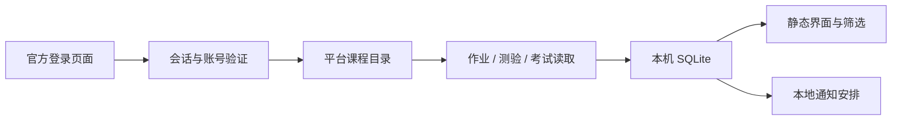

# 项目结构与数据流

课期是原生 Android 外壳加 APK 内置静态界面的应用。无需自建服务器；平台官方 WebView 完成登录，原生后台读取任务并安排本地通知。

```text
.github/                 Issue 与 PR 模板
docs/                    使用、开发、架构、测试、发布、CI 模板与检查记录
mobile/assets/           本地 HTML/CSS/JS、开源声明
mobile/src/com/keqi/reminder/
                         Android 外壳、平台适配、数据与提醒
mobile/res/              Android 资源
mobile/tests/            JVM 样例与回归检查
mobile/*_test.py          JVM/Edge 检查入口
mobile/lib/              固定 JAR 依赖与校验清单
mobile/preview/          明确标注的示例截图
scripts/check_repo.py    项目资料与依赖检查
```

## 从登录到提醒



| 模块 | 职责 |
| --- | --- |
| `MainActivity` | 仅向 APK 内置界面提供受控 Native 动作，渲染本机状态 |
| `LoginActivity` / `Authentication` / `ConnectionPolicy` | 官方登录导航、账号和受保护页面证据检查 |
| `Sessions` / `Secrets` | WebView Cookie 与 Keystore 加密会话备份 |
| `SyncEngine` / `SyncJob` | 平台同步与 Android 后台调度 |
| `Chaoxing*` / `MoocCourses` / `Collectors` | 官方页面/RPC读取、就绪判断、课程与任务解析 |
| `Store` / `CourseSelection` | SQLite 事务、数据合并、持久选课与移出策略 |
| `Core` / `Notifications` / `AlarmReceiver` | 日期与提醒身份、调度、完成/隐藏后的取消 |
| `assets/app.js` | 本机状态展示、课程/日期筛选、编辑草稿与原生调用 |

## 保守的数据合并

任务按平台身份和阶段分别保存。提交和互评不共享完成状态；考试列表读取不触发考试开始。截止和状态缺少证据时保留未知，详情失败保留旧截止并注明核实时间。部分同步不会清空未读到的任务。

课程的 `enabled` 控制普通任务视图与提醒；`removed` 是独立的本机排除标志。同步先合并最新课程选择，再决定写入任务，避免正在执行的同步恢复已移出的课程。普通快照排除移出课程及任务；显式重新导入入口读取 `removedCourses`。本机保留历史记录便于撤销和恢复。

平台会话按账号校验，页面导航限定受信任地址与只读入口。原生界面的接口不暴露给官方登录/课程页面。不要为了兼容某一页面而放宽这些边界。

## 已知限制

平台适配依赖官方网页字段及内部 RPC，没有官方开放 API 稳定性保证。学校定制系统、列表外考试、通知公告不保证覆盖。Android 省电和后台限制会影响检测及提醒时机。实际范围和证据见 [验证记录](../mobile/验证记录.md) 与 [使用说明](USAGE.md)。
