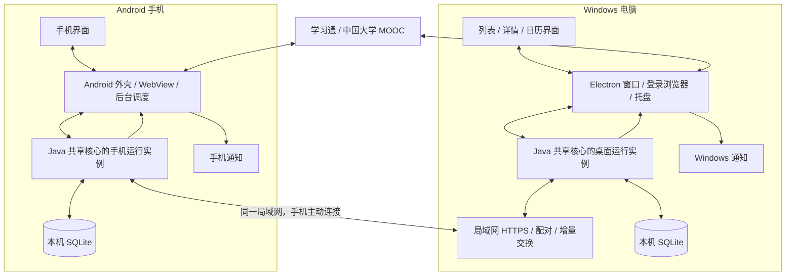

# 课期电脑与手机联动：框架设计

当前状态（2026-10-11）：0.11.0 开发实现已加入仓库。下文保留原设计目标；以本节和 [实际使用说明](DESKTOP_USAGE.md) 区分已实现与后续目标。

- 已实现 C1—C6 的主要流程：双端独立读取、局域网配对与交换、课程选择、手动待办/备注/子任务/批量操作/重复任务、桌面托盘与本地通知。
- `Workspace` / `TaskService` / `Repeats` 为共享核心；平台纯解析继续复用安卓源文件，MOOC 课程分页提取为 `MoocCatalog`。
- 首版事务存储使用 SQLite 元数据中的版本化 JSON，未拆成下文建议的逻辑 SQL 表。增量以实体修订选出变化的完整字段版本头，操作回执随响应交换；没有压缩历史、分页拉取或长连接推送。
- 电脑生成证书并在二维码中提供 SHA-256 指纹；手机核对该证书、等待电脑确认并保存 Keystore 加密令牌。使用 IPv4 和单台电脑工作区。
- epoch 或工作区不匹配时停止并保留 outbox。自动重建旧主机日志、跨工作区迁移、多主机和 IPv6 尚未实现；首版不会自动将旧工作区整库覆盖到另一台电脑。
- 自动检查覆盖规则、匿名页面、实际 Electron UI、HTTPS 认证/去重/撤销和 SQLite 回滚。iQOO / OriginOS 实机扫码、真实学校账号、锁屏提醒和网络隔离情况尚未验证。

---
日期：2026-10-11。状态：原设计目标保留；当前实现情况见上文。

依据：[功能草案](DESKTOP_REQUIREMENTS.md) 中用户明确确认的 C1—C6；C1 已按最新要求改为局域网同步。具体技术选择和功能细节是本方案的建议；本次更新设计，不创建工程、不改安卓代码，也不发布安装包。

## 1. 推荐结构

推荐 **Electron 桌面外壳 + 两端共用 Java 核心 + 各端 SQLite + 电脑内置局域网同步入口**。优先面向用户当前的 Windows 11 x64 和现有 Android 8.0+ 手机端。

电脑安装包附带 Java 17 运行环境，普通用户不需要安装 JDK。Java 核心保持 Android 可用的 Java 8 语言/API 范围，不把 Android 类带入桌面。浏览器、数据库和通知通过不同 Adapter 接入同一批任务规则。



两端各自登录、读取和提醒。电脑在运行或驻留托盘时，内置入口交换任务及人工修改，合并日志保存在电脑 SQLite；手机保存自己的完整任务副本和未同步修改。电脑关机、退出或休眠时手机继续独立运行，待下次可连接后补同步。两端都未运行时不会发现平台新任务。

首版一个工作区由一台电脑承担同步主机；普通用户不需要另外安装服务器、注册云账号或购买订阅。离开该局域网时不进行远程交换。

## 2. 选型及取舍

| 方案 | 适用性与取舍 | 本次建议 |
| --- | --- | --- |
| Electron + Java 核心 | 浏览器会话、窗口与托盘由 Electron 管理；Java 保留已有解析和领域规则。需要附带 JRE，安装体积和内存成本较高 | 首选，以复用读取规则和调试便利为依据；体积、启动和驻留内存后续测量 |
| Electron + 全部改写为 TypeScript | 桌面不带 JRE，但需要重新实现现有 Java 解析、账号验证及状态规则，维护两套业务实现 | 暂不选，避免把双端联动与大规模规则重写绑定 |
| Tauri + Java 核心 | Windows 使用 WebView2，仍可共享 Java，但增加 Rust 外壳及新的浏览器 Adapter | 保留候选；若 Electron 的实际性能不满足要求再评估 |
| .NET + WebView2 + Java 核心 | 面向 Windows，可共享网页界面和 Java，但新增 C# 外壳维护 | 保留候选，首版不同时维护多个桌面外壳 |

Electron 的 `session` 管理 Cookie/会话并支持 Chromium 网络请求；原生 `Tray` 提供托盘能力。这些能力来自官方文档，不能据此断言学校登录兼容性已经验证。[Session](https://www.electronjs.org/docs/latest/api/session)、[Tray](https://www.electronjs.org/docs/latest/api/tray)。Tauri 在 Windows 使用 WebView2，见 [官方说明](https://v2.tauri.app/reference/webview-versions/)。

SQLite 在 Android 使用已有系统数据库，在桌面通过 JDBC Adapter 接入。SQLite JDBC 的上游提供 Windows 原生库；未来发行固定依赖版本、哈希和许可，并单独验证运行环境，当前未下载新依赖。[上游项目](https://github.com/xerial/sqlite-jdbc)。

## 3. 从现有项目提取什么

### 可以共享的实现

- 任务身份、日期精度、原始截止与补充截止的计算规则。
- MOOC 与学习通课程/作业/考试解析；提交与互评的阶段判定。
- 页面就绪、部分读取保留、账号一致性及 HTTP 202 浏览器续读策略。
- 课程启用/移出/恢复的规则。
- 新增的手动待办、子任务、重复实例、操作日志和冲突投影。
- 提醒计划计算，不包含调用某个操作系统通知的代码。

起点包括 `Core`、`Collectors`、`ConnectionPolicy`、`CourseSelection`、`ChaoxingCourses`、`ChaoxingExams` 和读取策略。不是直接把整个 Android 源码打成桌面 JAR：当前 `Store`、`Authentication`、`SyncEngine` 等包含 Android 数据库、CookieManager 或 Context，需要先提取 Interface 与纯规则。

### 分别保留的 Adapter

| Seam | 手机 Adapter | 电脑 Adapter |
| --- | --- | --- |
| 平台页面读取 | 官方 WebView、现有 HTTP 读取及浏览器续读 | 官方登录窗口、Electron 独立 session、普通请求及浏览器续读 |
| 本地数据事务 | Android SQLite | JVM SQLite JDBC |
| 通知输出 | AlarmManager / Notifications | Electron Notification 与托盘入口 |
| 运行调度 | 前台事件与 JobScheduler | 主进程定时、托盘驻留、休眠恢复事件 |
| 机密保存 | Android Keystore / Secrets | Windows safeStorage Adapter |
| 界面宿主 | MainActivity 受控 Native 动作 | preload 受控 IPC 动作 |
| 同步传输 | 原生 HTTPS 客户端与 Android NSD 发现 | JVM HTTPS 入口与 DNS-SD 发布；本机命令直接调用同一事务核心 |

共享的是规则和协议，数据库文件、Cookie 和操作系统状态不会跨设备复制。

## 4. 模块与 Interface

这些 Interface 是设计说明，不是本次新增的代码。调用者使用结构化命令和结果，不能任意读写数据库或执行 JavaScript。

| Module | 对外 Interface | 内部承担的行为 |
| --- | --- | --- |
| TaskModule | `query(filter)`、`apply(command)` | 查询、手动任务、人工标记、子任务、备注、批量操作；手机事务保存 outbox，电脑事务保存共享操作与增量 |
| PlatformModule | `read(platform, account)`、`state(platform)` | 课程发现、只读入口、解析、任务身份、就绪判定、部分失败；返回任务观察记录 |
| RecurrenceModule | `materialize(series, range)`、`change(command)` | 生成有稳定身份的实例、本次/后续编辑、暂停/结束、月末和时区规则 |
| SyncModule | `synchronize(reason)`、`state()` | 已配对主机发现、身份核对、上传队列、增量拉取、重试、快照恢复、冲突；合并重复触发 |
| LanHostModule | `start(network)`、`pair(command)`、`devices(command)` | 电脑端监听与发现发布、配对凭证、撤销、受控协议入口；调用同一合并事务核心 |
| ReminderModule | `plan(snapshot, now)` | 生成需安排、取消和补充展示的计划；由本机 Adapter 执行 |
| BackupModule | `export(scope)`、`restore(archive)` | 版本校验、恢复预览、数据映射；不导出会话或复用备份设备身份 |

`apply` 只接受列举的命令，例如创建待办、编辑用户字段、处理任务、修改子任务、调整课程范围和恢复回收站；校验类型、字段及账号范围。返回已提交的变更摘要和可用的撤销信息，通知与界面随后响应这些变更。

### Electron 与 JVM 的连接

Electron 主进程启动安装包内固定路径的 Java 程序；使用参数数组和管道，隐藏控制台，不经 Shell 拼接命令。Node 提供带管道及 `windowsHide` 选项的子进程能力，见 [官方文档](https://nodejs.org/api/child_process.html)。

- 使用带请求 ID、消息类型、协议版本的 JSON 消息；长度及等待时间有上限。
- Java 需要页面时发出 `readPage` 请求；主进程检查平台、账号、入口及导航后返回结果。Java 不持有浏览器配置目录。
- stdout 只传协议，日志走经过脱敏的 stderr；Cookie、登录 HTML、配对凭证和认证码不写日志或同步操作。
- JVM 异常退出时保留 SQLite 与上传队列，主进程有限次数重启并显示故障；不宣称异常期间提醒正常。
- Electron 获得单实例锁；JVM 独占本机任务数据库写入，窗口与后台不能启动两个写入核心。

### 本地界面与官方网页隔离

本地任务界面从限定的应用协议加载静态资源，使用受限 CSP。preload 只向该界面暴露列举的任务动作，不暴露原始 IPC、文件读取或 Shell；主进程每次校验发送窗口、主 frame 及受信任 origin。

官方登录/课程页面使用独立窗口或 WebContentsView，与本地界面分开 session；不装任务 preload，不获得任务数据库接口。远端页面关闭 Node integration，开启 context isolation、sandbox 和 webSecurity；按受控平台地址验证导航与新窗口，不忽略证书错误。遇到人工验证转到可见的官方页面，不自动处理验证码。

普通读取与浏览器续读使用同一平台账号 session，限定为列表/详情等只读入口；不能为了读取考试安排触发开始考试。主进程只将必要页面结果传给共享解析 Module，页面脚本不能直接发送任务修改命令。这些设置依据 [Electron 官方安全文档](https://www.electronjs.org/docs/latest/tutorial/security)，仍需未来检查实际窗口及 IPC 配置。

## 5. 任务模型与本地数据

### 共享对象

| 对象 | 主要字段/用途 |
| --- | --- |
| 平台账号范围 | 平台、经过验证的来源用户 ID 派生身份；与同步身份分开 |
| 课程与课程偏好 | 账号范围、课程/学期/班级身份、名称；独立保存启用与移出意图 |
| 平台观察记录 | 来源任务 ID、阶段、类型、原始状态/时间、日期精度、字段是否本轮核实 |
| 手动任务 | UUID、标题、可选课程、截止、优先级、处理标记、重复来源 |
| 用户任务字段 | 人工处理、补充截止、备注、优先级、标签、提醒、稍后提醒 |
| 子任务 | UUID、父任务、标题、顺序、处理状态；逐项修改而非覆盖整个数组 |
| 重复系列及例外 | 系列 UUID、规则、时区、起点、结束/暂停、单次例外、规则分段 |
| 同步操作与冲突 | 操作身份、实体、字段、已观察版本、值、上传结果；保留并发版本 |

### 本机对象

设备设置、平台会话、读取健康状态、本机通知计划与发送回执、界面草稿、同步游标与上传队列分别保存。任务的共享修订不复用旧的提醒 `version`。电脑另保存设备登记、撤销、配对状态、操作回执和已提交增量；与本机任务共用一个 SQLite 事务核心，不再引入第二个权威数据库。

建议本机以逻辑表区分 `source_observations`、`tasks`、`task_user_fields`、`subtasks`、`recurrence_series`、`recurrence_exceptions`、`course_preferences`、`outbox`、`field_heads`、`sync_meta` 和 `local_notices`。实现阶段再确定索引及兼容的 SQL 语法，不使用只有桌面新 SQLite 才支持的业务必需功能。

### 必须修正的现有身份问题

当前 [LoginActivity](../mobile/src/com/keqi/reminder/LoginActivity.java) 保存两个不同值：`sourceAccount` 是验证后的平台用户 ID，`account` 是本机 UUID。[Collectors](../mobile/src/com/keqi/reminder/Collectors.java) 使用后者参与任务 ID。因此同一账号在另一台设备上会产生不同的旧任务编号。

新共享身份使用版本化、无歧义编码的完整元组：

`同步工作区 + 平台 + 已验证来源账号 + 课程/学期/班级 + 来源任务 ID + 阶段`

课程身份也包含账号范围，避免不同账号同一课程共用启用设置。保留 `legacy_id → canonical_id` 映射；没有来源账号证据的历史任务先保留为本机缓存，完成身份验证后再共享，不按课程名猜测。未配对时先使用本机临时范围，首次配对再映射到固定工作区；地址变化或重连不重建任务身份。

## 6. 重复任务

- 日/周/月规则基于指定时区及当地日历时间，使用同一 Java 计算实现。
- 实例身份由系列 UUID 与原始周期槽位派生，不能使用每台设备新生成的随机 UUID；槽位包含稳定规则段身份与该段的周期/星期位置，单次改截止不改变该实例身份。
- 默认保存并展示未来 30 天的实例，属于生成窗口，不是只能规划 30 天；查看更远日期时按需生成，两端离线生成后去重。
- 未完成的历史实例保留；没有日期的待办不进入截止计算。
- 每月 29/30/31 日遇到短月按明确选项处理；时区夏令时不存在的时刻顺延到首个有效时刻，重复时刻选较早偏移，并在编辑器预览。
- 编辑本次保存例外；编辑后续将规则切成前后两段，保留历史实例。系列不因规则编辑换 UUID，新规则段身份由该次规则编辑操作派生，两端采用相同的分段与起点。
- 规则变更使已生成的远期实例不再适用时，将它们标为被替代，不继续在普通列表重复出现；若用户已经编辑或处理，保留记录并展示转移/保留选项，不能硬删除人工内容。
- 系列结束/改规则后，旧设备上传的远期生成实例由电脑主机检查当前有效规则段；无效候选不恢复到普通列表，用户编辑及历史证据仍可找回。
- 暂停停止未来自动产生和提醒，已生成未处理实例保留；恢复时展示漏过周期，用户选择保留或跳过，不默认为已处理。
- 完成本次不会自动完成下次；平台任务附加的子任务不驱动平台提交。

并发修改重复规则保留冲突，暂停有歧义的未来生成，已有任务仍可查看和处理。避免两个不一致规则各自不断生成远期实例。

## 7. 局域网发现、配对与主机

电脑 JVM 提供受限的 HTTPS 同步入口，手机通过原生客户端访问；不依赖后台持续运行 WebView 或保持长连接。桌面运行环境需要包含 `jdk.httpserver` 模块，TLS 入口可采用 Java 17 的 [HttpsServer](https://docs.oracle.com/en/java/javase/17/docs/api/jdk.httpserver/com/sun/net/httpserver/HttpsServer.html)。证书生成与安全保存由桌面 Adapter 负责，实现时固定依赖与发行清单。

### 首次关联与日常连接

1. 电脑选择可互通的局域网，打开“连接手机”，建立固定工作区与主机身份；展示有效期 5 分钟的一次性二维码。
2. 二维码包含协议版本、工作区/主机 ID、局域网地址与端口、主机证书 SHA-256 指纹、至少 128 位随机配对秘密及过期提示。没有摄像头时可输入或粘贴完整配对字符串，不能只靠容易穷举的短数字识别电脑。
3. 手机先核对二维码中的证书指纹，再通过 HTTPS 发送一次性秘密申请登记；电脑显示手机名称并确认关联。登记成功后秘密失效，主机签发至少 256 位随机设备令牌。
4. 手机保存主机身份、指纹和设备令牌；以后打开软件、编辑或连接恢复时自动发现并交换，不需要重复扫码或登录第三方账号。来源账号仍在各端官方平台验证。
5. 初次连接先保存两端现有记录，再合并主机快照和本机用户修改；空电脑库不会覆盖手机数据。退出/重连同一工作区不重新导入一份任务。

配对流程是推荐设计，当前没有生成证书、开放端口或添加相机权限。相机仅在用户选择扫码时请求，文本配对仍可使用。

### 发现与网络边界

- 手机使用 Android NSD，电脑使用 DNS-SD/mDNS 发布服务；建议桌面采用 JmDNS Adapter，服务类型在实现前固定。广播只含主机 ID、协议版本与端口等连接元信息，不含任务、平台账号或配对秘密。Android NSD 和 JmDNS 都提供局域网服务发现能力，见 [Android 官方说明](https://developer.android.com/develop/connectivity/wifi/use-nsd)、[JmDNS 上游](https://github.com/jmdns/jmdns)。
- 发现结果只提供候选地址；每次连接仍核对已保存的证书与主机身份，不能信任同名广播、Wi-Fi 名称或请求声明的设备 ID。
- 端口首次选可用值并保存，冲突时换可用端口并重新发布；DHCP 地址变化通过发现更新。自动发现不可用时可以手动更新 IP/端口，身份固定不变。
- 监听限定为用户选择的局域网接口，地址变化后重新绑定；不默认监听 VPN 或全部网卡，不创建公网映射或穿透。电脑网线与手机 Wi-Fi 可互通即可，不要求无线连接方式相同。
- Windows 只为必要应用/端口及可信局域网放行；检查同一 Wi-Fi 的设备隔离和多网卡路由。手动地址不能突破校园网或访客网的设备隔离，需换可互通网络或验证热点连接。
- 手机为该同步请求选择已发现服务所在的本地网络，不因 Wi-Fi 无互联网而走移动网络；平台请求保留独立联网策略，不全局切换进程网络。
- 安卓局域网权限按系统与 target SDK 处理，拒绝/撤销时显示明确原因；升级 SDK 后重新验证。Android 16 的可选保护与后续版本的权限要求见 [官方说明](https://developer.android.com/privacy-and-security/local-network-permission)，不能把所有版本都假设为无需权限。

局域网没有互联网时，保存好的任务与人工编辑仍可交换；平台读取单独等待互联网恢复。前台发现限定时间，后台使用系统允许的短时尝试，不无限扫描或锁住手机网络。

### 配对凭证与设备解绑

- 每台电脑工作区独立。主机只保存设备令牌的校验摘要，每次请求根据有效登记推导工作区；校验撤销状态，不信任请求附带的所有者或工作区声明。
- 采用 HTTPS 和指定主机证书校验；动态信任只存在于局域网 Adapter，不能全局跳过证书检查，也不能改变官方学习通/MOOC 浏览器的 TLS 策略。
- 配对入口仅在用户开启配对窗口时可用，秘密单次、限时、限速；配对二维码不进日志、历史记录或普通备份。失效后需要在电脑重新生成。
- Windows 主机私钥和本机凭证由 safeStorage Adapter 保护，Android 设备令牌使用 Keystore；不放页面 localStorage、普通配置或同步数据。见 [Windows safeStorage 官方说明](https://www.electronjs.org/docs/latest/api/safe-storage)。
- 设备管理可解绑手机；每个数据入口即时拒绝被撤销令牌。旧手机更换设备名称/UUID不能重新登记，重新授权需要新的配对流程。
- 手机可本地取消关联，电脑可撤销授权；解绑停止未来交换，不能抹除失联设备的本机缓存。清空本机、解绑与删除工作区数据分别表达。
- 恢复备份不复用旧设备令牌；证书丢失或更换电脑后重新核对身份和配对，先预览数据合并范围。首版不承诺无备份情况下自动找回电脑已丢失的数据。

### 合并入口与离线行为

手机操作通过受控 HTTPS 入口提交，电脑本机命令通过受信任 IPC 调用同一校验与合并核心。两种路径使用相同的操作身份、版本头、删除意图和已提交修订；电脑不绕过合并规则直接覆盖共享字段，也不必经 HTTP 访问自己。

手机离线先提交本机 SQLite 与 outbox，电脑离线先提交本机共享日志；下次连接按回执和持久游标双向补齐。电脑不在线时，手机仍能创建重复实例、编辑任务、读取平台和提醒；不能接收尚未交换的电脑修改。具体事务及冲突规则见 [同步协议](DESKTOP_SYNC_PROTOCOL.md)。

## 8. 自动调度与通知

| 触发 | 电脑 | 手机 |
| --- | --- | --- |
| 编辑并保存 | 立即提交本机共享日志，随后通知界面；手机下次拉取取得修改 | 本机立即保存，短暂合并连续输入后自动尝试上传并拉取 |
| 打开/恢复网络/重新登录 | 启动或重绑局域网入口、发布地址并执行需要的平台读取 | 自动发现已配对电脑、补同步；平台登录恢复只影响本机读取 |
| 前台接收另一端修改 | 手机提交后在事务完成时通知桌面界面，无需网络轮询自己 | 建议前台 30 秒检查修订并拉增量；本机保存时立即尝试交换 |
| 后台运行 | 托盘保持局域网入口；平台读取默认沿用 30 分钟档，可设置 | 合并到原生 JobScheduler，默认 30 分钟档；允许系统延迟与短时发现 |
| 休眠/重新启动 | 暂停时不提醒；恢复后补同步、重算计划及汇总错过提醒 | 按系统许可补任务，保留已有本机提醒 |

以上频率是建议配置，不是送达 SLA；断网、系统权限和后台限制分别显示。安卓的后台限制是系统行为，见 [Android 官方说明](https://developer.android.com/about/versions/oreo/android-8.0-changes)。

提醒 ID 包含本机设备、共享任务身份、有效截止、提醒档和本机计划修订；备注编辑不重新触发已有截止提醒。每次本机任务改变或收到远端变更后，重建需取消/新增的计划；平台已完成、人工已处理或课程移出后取消后续提醒。

Windows 关闭主窗口时驻留托盘；明确退出则停止核心与调度。建议首版通知点击打开详情，处理/稍后提醒可在详情及托盘完成；若加入通知上的直接操作按钮，另做 Windows 激活验证，不假定所有平台通知操作能力相同。

电脑安装使用 Electron Forge 的 Squirrel.Windows，统一设置开始菜单入口与通知身份；不能仅凭开发时弹过通知认定安装后可用。Windows 通知有快捷方式及激活身份要求，见 [通知说明](https://www.electronjs.org/docs/latest/tutorial/notifications)、[安装器说明](https://www.electronforge.io/config/makers/squirrel.windows)。

## 9. 桌面界面框架

建议三栏：左侧导航，中间紧凑任务列表，右侧任务详情。导航包括今日、近期、全部、日历、课程及设置/同步；窗口窄时详情切换为独立面板。

列表保持现有克制的风格：明确课程名、任务标题、截止与状态，色彩只强调紧急程度和类型。批量选中后出现操作栏，退出多选恢复普通行操作；同步问题用短摘要及展开详情，不堆长错误横幅。

详情承载原始平台证据、人工状态、子任务、备注和重复设置；用户输入先保存到本机，明确显示是否已同步。课程批量编辑沿用草稿/统一保存/取消，避免点击即向手机传播误操作。

建议快捷键 `Ctrl+N` 新建、`Ctrl+F` 搜索、`Esc` 返回/关闭详情；多选快捷键只在列表获得焦点时生效，不抢文本编辑操作。底部或设置中分别显示平台读取、双端同步和本机通知健康状态。

## 10. 手机升级与迁移

当前 [Store](../mobile/src/com/keqi/reminder/Store.java) 只有数据库版本 1，`onUpgrade` 直接抛错；不能直接提升版本并上线。

迁移步骤建议：

1. 通过数据库一致性备份机制保存迁移前快照，不在运行中直接复制一个 WAL 数据库主文件。
2. 在事务中建立新表与迁移标记；拆出平台事实和用户字段，保存旧任务/课程身份映射。
3. 从连接配置的 `sourceAccount` 确定来源身份；缺证据记录保持本机可见、可处理，待验证后再同步。
4. 保留 `localDone`、`manualDue`、`snoozeUntil`、课程启用/移出、首次发现时间及已发送通知回执，避免升级重新提醒旧记录。
5. 事务提交后取消旧通知计划并重建；迁移期间接收器识别旧 ID 或延后处理，避免触发迁移一半的记录。
6. 首次配对将临时本机范围映射到主机工作区；旧修改使用初始导入操作：空主机库建立基线，有共享值时保留为候选并显式合并，不把旧缓存包装成最新平台读取。
7. 失败时回滚并保留旧数据；新版本不能完成迁移则报告原因，不以清空数据库继续启动。

手机增加扫码/文本配对及设备页、手动待办编辑器、子任务、备注、重复规则和冲突处理。保留原有列表及课程入口，桌面能力通过同一模型进入手机，避免只在电脑可编辑。

## 11. 未来目录

以下为设计目标目录，本次没有创建这些工程：

```text
shared/
  core-java/               任务、解析、重复、同步合并与客户端规则
  contracts/               JSON 对象与命令协议版本
  fixtures/                匿名解析、合并和时间测试样例
desktop/
  host/                    Electron 窗口、托盘、IPC、浏览器 Adapter
  renderer/                HTML/CSS/JS 列表、详情及日历
  jvm/                     桌面入口、JDBC、浏览器消息 Adapter
    lan/                   HTTPS、配对凭证、DNS-SD 与网络绑定 Adapter
  tests/                   主机事务、局域网连接、配对及恢复验证
  packaging/               Forge 配置及运行环境打包清单
mobile/                    保留现有 Android 工程与构建入口
docs/                      功能、框架、协议、验证与发布说明
```

保留 APK 原签名及构建流程；实现时让手机构建读取共享 Java 源码，并将它们加入现有源码指纹与测试路径。桌面分别打包纯核心、JVM JSON 依赖、SQLite JDBC、JRE；当前 `json-tests-only.jar` 的“仅测试”归属不能直接沿用为桌面生产清单。新增发行依赖逐项列入第三方声明，不把运行环境二进制提交进源码库。

## 12. 实施顺序与未来验收

这些是未来实施顺序与验证要求，不代表本次执行或已经通过。

| 阶段 | 交付内容 | 进入下一阶段的证据 |
| --- | --- | --- |
| A 可行性 | 桌面两平台登录/读取、局域网 HTTPS/发现/配对、基础通知与 Java 运行实例 | 真实账号核对课程与考试、用户网络手机直连、安装后通知；验证隔离/手动地址与权限，失败则调整 Adapter |
| B 共享核心 | 提取纯 Java 规则、稳定身份、Android/JVM 数据 Adapter、原有读取行为保持 | 原有回归通过，移动/桌面同样例输出一致；历史身份迁移保留人工修改 |
| C 本地任务 | 手动待办、子任务、备注、批量和重复；手机同步增加编辑能力 | 断网与重启数据保留、时间边缘样例、批量撤销和重复实例去重 |
| D 局域网联动 | 配对、设备、上传队列、增量、冲突、移出传播与快照 | 同一网络自动交换；离网后重连、电脑关机再上线、地址变化、丢响应重试、撤销设备、首次合并不丢数据 |
| E 桌面体验 | 三栏界面、搜索、日历、课程管理、托盘、独立通知 | 安装/退出/休眠恢复、无障碍键盘、多任务量下响应、双端通知取消 |
| F 发布 | Windows 安装包与同签名安卓更新、迁移/备份文档、依赖许可 | 干净机器安装、旧手机数据升级、完整场景抽查与可恢复性 |

A—F 合在一起才构成用户要求的联动软件，不把某个中间阶段当作最终完成。

## 13. 需求到框架的覆盖

| 用户确认/功能目标 | 设计落点 |
| --- | --- |
| C1 免费局域网自动同步 | 第 7—8 节及同步协议：电脑内置主机、配对/发现、自动触发、增量、离网和电脑离线后的补同步 |
| C2 手动待办、子任务、备注、批量 | 第 4—5、9—10 节：共享 TaskModule、用户字段与两端编辑界面 |
| C3 托盘与到期通知 | 第 1、8、12 节：Electron 驻留、各端计划、系统激活与安装验证 |
| C4 两端独立平台读取 | 第 1、3—5 节：同一解析规则、两个浏览器 Adapter、稳定身份 |
| C5 课程范围一致 | 第 5 节及同步协议：共享课程偏好、移出记录和显式恢复 |
| C6 个人事务及重复 | 第 5—6 节：可选课程、系列/实例/例外、周期身份与冲突 |
| 手机现有数据及功能保留 | 第 3、10—12 节：共享核心提取、迁移、通知回执与原有回归 |
| 框架、数据流、模块、目录及顺序 | 第 1、4—5、11—12 节；协议补充跨端事务与异常流程 |

阶段 A 的实机、网络和性能事实仍需要未来验证；完成本文件表示设计已覆盖需求，不表示软件已实现或选型已经通过原型验证。
