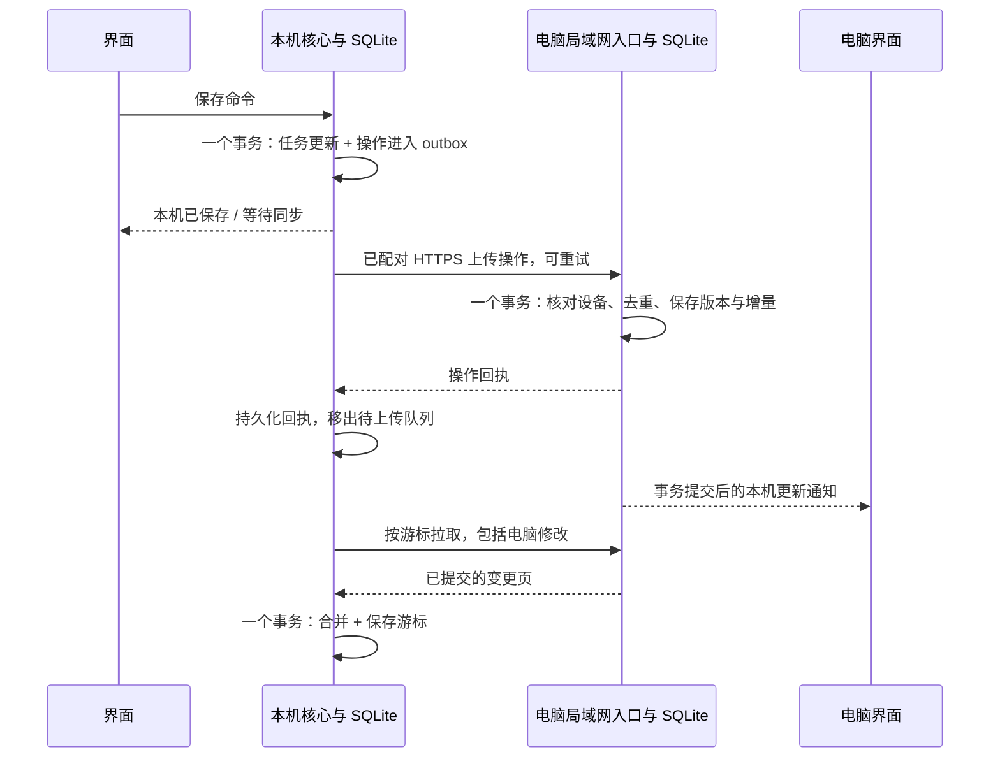

# 课期双端同步协议设计

当前状态（2026-10-11）：0.11.0 开发实现已加入仓库。下文保留原设计目标；以本节和 [实际使用说明](DESKTOP_USAGE.md) 区分已实现与后续目标。

- 已实现 C1—C6 的主要流程：双端独立读取、局域网配对与交换、课程选择、手动待办/备注/子任务/批量操作/重复任务、桌面托盘与本地通知。
- `Workspace` / `TaskService` / `Repeats` 为共享核心；平台纯解析继续复用安卓源文件，MOOC 课程分页提取为 `MoocCatalog`。
- 首版事务存储使用 SQLite 元数据中的版本化 JSON，未拆成下文建议的逻辑 SQL 表。增量以实体修订选出变化的完整字段版本头，操作回执随响应交换；没有压缩历史、分页拉取或长连接推送。
- 电脑生成证书并在二维码中提供 SHA-256 指纹；手机核对该证书、等待电脑确认并保存 Keystore 加密令牌。使用 IPv4 和单台电脑工作区。
- epoch 或工作区不匹配时停止并保留 outbox。自动重建旧主机日志、跨工作区迁移、多主机和 IPv6 尚未实现；首版不会自动将旧工作区整库覆盖到另一台电脑。
- 自动检查覆盖规则、匿名页面、实际 Electron UI、HTTPS 认证/去重/撤销和 SQLite 回滚。iQOO / OriginOS 实机扫码、真实学校账号、锁屏提醒和网络隔离情况尚未验证。

---
原始协议草案（实施前，2026-10-11）；当前实现和边界见本文件开头。

配套：[功能草案](DESKTOP_REQUIREMENTS.md)、[框架设计](DESKTOP_ARCHITECTURE.md)。下面的名称、数据结构和限制用于把预期行为说清楚；具体序列化 schema、SQL 与样例在实现阶段固定。

## 1. 三类数据分别处理

1. **平台观察**：真实读取产生的状态/时间证据，不等于一份从旧数据库导出的任务。
2. **用户编辑**：手动待办、子任务、备注、处理标记、补充截止、重复及课程偏好。
3. **本机状态**：平台 Cookie、认证令牌、通知回执、读取错误、界面状态与设备设置。

前两类按明确字段交换；第三类不混入任务操作。同步导出使用允许的字段清单，不能把当前整个 `connections` 或 `snapshot` JSON 原样上传，因为它们包含本机连接信息。

## 2. 稳定身份

| 对象 | 身份来源 |
| --- | --- |
| 同步工作区 | 电脑首次建立的固定 UUID，通过配对关联手机；个人首版一个电脑主机 |
| 主机 | 与工作区关联的固定 UUID 及受保护证书；IP/端口变化不改变身份 |
| 设备 | 本机随机 UUID；登记绑定主机签发的设备凭证，恢复备份时重新生成 |
| 平台账号范围 | 工作区、平台与已验证的 `sourceAccount` 的版本化编码派生值 |
| 课程 | 账号范围、平台课程身份、学期与必要班级身份 |
| 平台任务 | 课程身份、平台来源任务 ID、提交/互评阶段；与框架中的完整元组一致 |
| 手动待办/子任务/系列 | 创建时的 UUID；跨端保留 |
| 重复实例 | 系列 UUID 与原始周期槽位派生；槽位含稳定规则段与该段周期位置，单次改截止不换身份 |
| 操作 | 设备 UUID 与单调递增本机计数；计数与操作在同一事务中提交 |

身份元组使用有版本的无歧义编码，不以标题、电话、Cookie 或设备自己的时钟作为唯一身份。来源 ID 缺失的解析结果保留“身份待确认”，不猜测合并。

当前手机的旧任务编号包含本机 UUID，应通过保存的来源元数据迁移；旧 UUID 是本机隔离信息，不是跨设备平台账号身份。旧编号映射、任务人工字段及通知回执需要同时保留。未配对时允许本机临时范围，首次关联事务性映射到工作区；重连同一主机不重复映射。

## 3. 一次手机修改

先本机成功再通知界面，电脑不可达不回滚手机输入。上传成功但回执丢失时重发相同操作 ID，不能产生第二次创建、处理或重复实例。

电脑本机命令通过受信任 IPC，直接进入与手机相同的校验/合并核心；操作登记、内容投影与增量在一个事务提交，不需要向自己发 HTTP。电脑界面也在事务提交后更新。手机离线期间电脑修改留在共享日志中，供手机下次拉取。

批量编辑在本机一次事务内保存，输出一组有共同命令 ID 的逐字段/逐实体操作。手机上传按有限大小分批，界面明确剩余数量；只有收到主机回执并在本机持久化后才删除队列条目。

## 4. 操作信封

每项操作至少携带：协议版本、操作 ID、设备计数、实体类型/身份、命令类型、所修改字段及其已观察版本集合、值或删除/恢复意图。平台观察另带读取批次和证据字段。

客户端时间只用于展示及日期业务，不裁定并发编辑胜负。令牌、Cookie、验证码、浏览器全部 HTML、来源链接的认证参数不进入操作信封。

依赖尚未上传的本机操作应按设备顺序提交；主机遇到未满足的本机依赖返回 `needs_dependencies`，不会把缺依赖的编辑误当成覆盖。其他设备或紧凑历史的旧版本引用由相应版本/快照规则解释。

## 5. 字段合并及冲突

用户字段分别保存值与版本头集合，而不是以整份任务 JSON 的最后写入覆盖全部字段。

- 修改时带上该字段在本机已观察到的版本头；主机用新操作替换这些已观察版本，其他并发版本保留。
- 电脑改备注、手机改优先级，不冲突；同一备注两份不同修改形成冲突。
- 一台设备连续修改同一字段，后一次引用前一次本机操作；按依赖顺序上传后只保留最后的本地意图和未观察到的远端分支。
- 相同内容的并发版本可合并为同一展示结果，但保留足以支持下一次编辑的版本信息。
- 解决冲突提交新操作，并引用所有已看到的候选；此时又有未知并发编辑，仍显示剩余冲突。
- 子任务拥有自己的身份和字段。新增、完成及编辑一个步骤不能覆盖另一端新增的其他步骤；排序使用逐项顺序字段并稳定排序，同一项并发移动可提示冲突。
- 标签使用带身份的关联/移除记录，不能用旧的整个标签数组抹掉另一端添加。

普通查询显示已有值及冲突标记；备注保留原文与候选。处理状态有冲突时不自动认定任务已处理；提醒时间有冲突时显示日期待核实，并按较早的有效候选安排保守提醒，用户解决后取消旧计划。不能在冲突期间悄悄隐藏任务或延期到较晚时间。

## 6. 平台事实的合并

平台观察至少包含来源账号/任务、设备、批次、阶段覆盖、观察时间、字段是否本轮获得、日期精度、平台提供的更新版本（如果确实存在）及读取结果。

- 从缓存导入的记录标记为历史证据，不能冒充刚核实的数据。
- 字段未读到时保持未知/保留旧证据，不写空值擦除截止。列表部分失败不删除缺失任务。
- 平台有可比较的真实更新版本时按它判断；没有时，上传到达顺序和设备时钟都不足以证明平台事实新旧。
- 因此保留各端观察。明显来自旧缓存的证据不覆盖刚核实记录；两次真实读取相互矛盾且没有可靠先后证据时，显示“平台记录不一致”，保留候选并请求重新读取。
- 重新读取在已经观察到冲突后产生新的核实批次，用于解决冲突；自动解析不能以“已处理”覆盖平台状态。
- 平台官方确认取消、结束或完成可以作为状态证据；考试列表读取不触发开始考试。考试开始时间不能补成截止。
- 来源 URL 只保留可重新通过本机登录打开的受控任务定位，不共享一次性认证链接；任务页面打开由本机会话重新构造或校验。

收到另一端任务不自动宣称本机平台连接正常。平台登录过期或需要人工验证只影响该设备的读取，已共享数据仍可查看。

## 7. 删除、移出与恢复

| 操作 | 合并行为 |
| --- | --- |
| 关闭课程启用 | 共享用户字段；隐藏普通视图和提醒，仍可在课程管理启用 |
| 移出课程 | 保存独立移出记录；平台发现或旧启用操作不撤销移出 |
| 恢复课程 | 显式引用已观察到的移出记录；保留既有人工记录并重新读取 |
| 删除手动待办 | 进入共享回收站，保留内容与删除意图；与编辑并发时提示待处理内容 |
| 删除后的并发编辑 | 编辑保留在历史/回收站，不自动把任务放回普通列表 |
| 恢复手动待办 | 显式撤销已观察删除；恢复时可选择保留的并发编辑 |
| 断开某设备的平台登录 | 清除该设备会话、停止该设备读取；不充当共享删除操作 |
| 退出/解绑同步设备 | 停止其未来交换，不删除另一设备和共享区内容 |

移出与删除不得只通过“普通快照没有这条记录”表达，否则旧设备重新读取后会复活。真正清空共享数据是单独的明确操作，不复用断开连接按钮。

## 8. 电脑主机事务入口与增量

### 逻辑表

电脑 SQLite 中，`workspaces` 保存主机身份、协议、快照 epoch 及已提交修订；`devices` 保存设备令牌校验摘要、进度和撤销；`entities`、`field_heads`、`source_observations`、`conflicts`、`tombstones` 保存当前内容和排除意图；`operations` 保存去重及回执；`changes` 保存顺序增量。修订头只提供更新提示，与任务内容同属受认证入口，不开放数据库文件下载。

### 受控 Interface

| 入口 | 请求/结果与约束 |
| --- | --- |
| `request_pairing` | 仅在电脑开启配对模式时可用；核对一次性秘密，电脑确认后签发设备凭证；不允许凭设备 UUID 自动登记 |
| `push_ops` | 提交有限大小操作批次，逐项返回已接受/已存在/冲突/拒绝/依赖缺失及回执 |
| `pull_changes` | 按游标返回有序变更页、下一游标、是否还有页及快照 epoch |
| `get_snapshot` | 首次关联/游标失效时获取一致快照及其对应游标，包括版本头、冲突及移出记录 |
| `ack_progress` | 确认设备已持久化回执和拉取位置，支持安全整理历史 |
| `list_devices` | 已配对设备查询所在工作区的登记；不返回令牌或秘密 |
| `revoke_device` | 电脑本地受信任管理入口撤销设备；手机可以清除本机关联，旧凭证撤销后即时拒绝 |

工作区和设备由经过核对的设备凭证登记推导，不信任请求附带的所有者、设备或工作区字段。错误区分未配对、配对过期、凭证无效/撤销、身份不匹配、版本不兼容、网络/权限不可达、主机存储故障和操作不合法；永久拒绝的操作仍留在本机“需要处理”列表，不无限重试。

### 修订与原子性

电脑 JVM 为 SQLite 使用单写入队列，在写事务内串行分配增量修订；手机请求和电脑本机命令都经过该队列。操作去重、字段合并、冲突、变化日志和工作区修订在同一事务提交；没有提交就不发送成功回执或更新通知。不要在事务外先分配序号，否则客户端可能跳过稍后提交的较小序号。

拉取只返回已提交内容，客户端只推进到已应用页面的游标，不能直接跳到通知携带的“最新修订”。应用一页与保存游标是一个本地事务；崩溃后可重复拉取同一页。

快照及对应游标在一致视图内读取，不能先读取任务、再从另一个时刻取游标。首次合并或重建时先留存本机 outbox，导入快照后重放未确认修改，不能用快照替换整个本机数据库。

## 9. 发现、认证、解绑与重新配对

- 电脑发布 DNS-SD/mDNS 元信息，手机使用 Android NSD 发现；广播、IP 地址与 Wi-Fi 名称只用于找候选主机，不是认证证据。连接目标及网络绑定由局域网 Adapter 管理。
- 配对二维码携带主机/工作区 ID、协议、地址、证书指纹与至少 128 位随机秘密；有效期建议 5 分钟，只在电脑配对窗口开启时接受。手机先核对主机证书再发送秘密，电脑确认后签发至少 256 位随机设备令牌。
- 配对秘密单次消耗、失效后重新生成；配对请求限速，不根据设备自报名称授权。配对中断/回执丢失不能退回无认证连接，也不把秘密暴露到广播或日志。
- 所有任务读取/写入、修订头及快照入口均经 HTTPS，逐次校验设备凭证摘要、工作区和撤销状态；只公开最少的发现元信息。访问令牌只放受限请求头，不进入 URL、任务字段或浏览器脚本。
- 手机对指定主机校验证书指纹及身份，不能使用全局“信任所有证书”或修改官方网页证书规则。同名假广播、改写地址和其他电脑证书均不能取得令牌。
- 手机令牌保存在 Keystore 保护的机密存储，电脑证书私钥及本机机密通过 safeStorage Adapter 保护。主机数据库只存设备令牌校验摘要，不存可直接冒用的明文令牌。
- 撤销在主机入口立即生效，旧手机不能靠换 UUID/名称再次配对；需要电脑重新开启配对模式及确认。手机本地解绑停止交换，但不能远程抹去电脑或其他设备数据。
- 主机 IP/端口变化只更新地址；证书/主机身份变化需要重新核对和配对。首次关联其他工作区先显示迁移范围，不自动上传原工作区积压操作。

监听限定用户选定的局域网接口，Windows 仅为必要应用/端口及可信网络放行；不监听全部网卡、不自动建公网映射。发现失败可输入地址，设备互访被隔离则必须换网络。手机局域网权限与系统后台调度按版本处理；拒绝权限不影响本机保存和平台登录。协议不会因“同一网络”放宽认证。

主机重装/换机通过备份恢复工作区内容，生成新的设备凭证并重新配对；若主机日志回退或重建，变更快照 epoch，按下一节的重建流程处理。没有备份时可导入手机仍保留的内容，但不能保证恢复只存在于丢失电脑的记录；同步与备份分别提供。

## 10. 调度、失联、快照与协议升级

- 打开软件、保存修改、主机重新出现和局域网恢复时尝试交换。手机前台建议每 30 秒检查修订，有变化才拉增量；后台合并到 JobScheduler 建议 30 分钟档，允许系统延迟。
- 调用失败指数退避并加入随机延迟；尊重主机限流响应，不每秒重复完整读取或无限发现。重连后始终按持久游标补拉，发现结果不携带任务正文。
- 电脑关机/退出/休眠、手机离网或网络隔离时保留本机任务、提醒与待上传修改，显示“等待电脑上线/局域网连接”；手机仍独立读取平台。电脑托盘重新运行后恢复入口，手机下次可连接时自动补同步。
- 电脑本机事务完成后通过 IPC 通知界面；手机平台读取和手机后台同步不依赖电脑在线。两端无互联网但局域网可互通时仍可交换本机数据，平台读取另报状态。
- 操作日志可在设备已确认进度后整理；当前值、未解决候选、移出/回收站意图及未被设备确认的回执必须保留。
- 长期离线设备的旧游标失效后使用新快照；其未上传的用户编辑保留为候选重新合并，不能抹掉或作为旧平台读取覆盖新事实。
- 紧凑历史造成旧基准版本不可解释时，返回 `needs_rebase`：保留原操作内容，让设备获取快照并以明确的重新合并操作提交，不能给旧操作重新套一个“最新版本”静默覆盖。
- 备份恢复创建新设备身份；不得让旧备份的设备计数覆盖仍在运行设备的上传记录。
- 主机从旧备份恢复或日志重建时更换 epoch，拒绝继续使用旧游标；先留存手机 outbox、取得快照并预览重建范围，按 `needs_rebase` 重新合并。旧基准下的编辑、移出和删除意图保留候选，不能用旧整库自动复活已排除任务。
- 协议包含版本及最低可写版本；新结构不能被旧设备的整对象保存抹掉。版本不兼容时仍可查看本机缓存，提示升级并保留待上传修改。
- 主机磁盘满、数据库损坏或协议入口异常时拒绝确认未提交操作；手机保留 outbox，电脑保留可恢复记录，显示存储问题并提供备份/恢复路径。
- 更换电脑/工作区时分离数据，先显示迁移范围；不把旧工作区等待上传的操作自动发送给新工作区。没有任何云项目额度或闲置暂停流程。

## 11. 重复实例的同步

生成实例携带系列身份、规则段、原始槽位及实例基线。主机按确定的规则段和槽位去重；实例的标题、截止和子任务模板属于同一生成基线，不能把两端相同实例初建误报为两份用户冲突。

用户后续修改实例则使用普通字段版本。系列变更并发时保留两种规则，停止有歧义的未来生成。实例生成不依赖电脑一直在线；任一设备运行时可以补生成，另一端也会得到相同实例身份。

重复规则变更后，旧设备提交的派生实例应重新验证适用规则段和已存在的停止/例外意图；不合法的派生候选不覆盖用户历史记录，也不撤销暂停或结束。已经生成但失去适用规则的远期实例标记为被替代，保留其用户编辑/处理证据，避免旧规则和新规则的实例同时重复显示。

## 12. 未来验证场景

1. 同一来源平台账号两端独立读取，课程/学期/班级/阶段相同则一个任务；换账号或换阶段则分别保存。
2. 丢失上传回执后重试，只创建/处理一次；本机连续编辑按依赖顺序归并。
3. 不同字段离线并发不互相覆盖；同一备注保留候选，解决期间第三份修改仍可找回。
4. 移出与平台读取并发、删除与编辑并发、显式恢复均符合第 7 节。
5. 源字段缺失、缓存导入、设备时钟错误及无官方版本的两份矛盾观察，不冒充确定的最新证据。
6. 两个写入事务故意延迟提交，拉取不能跳过变更；页应用中崩溃不能提前保存游标。
7. 快照建立期间继续编辑、历史整理、旧游标重连和未上传修改重放，人工内容均可找回。
8. 其他工作区读取/写入、伪造设备 ID、无效/撤销令牌、过期配对秘密、假主机证书和同名广播全部拒绝；撤销后换设备名称也不能自动登记。
9. 两端离线生成重复实例、短月、时区、改本次/后续、暂停/结束后的旧候选不会重复或复活。
10. 平台会话、账号切换、导出备份和换主机/工作区不泄露或混淆数据；令牌与二维码不进入备份或日志。
11. 手机旧任务身份迁移、通知已发送回执和首次空主机库合并保留原数据；配对前后身份映射不复制任务。
12. 同一局域网自动交换、离网积压、电脑关机再上线、权限关闭、重启和后台延迟均有可理解状态。
13. 电脑网线配手机 Wi-Fi、DHCP/端口变化、多网卡、发现组播被禁后的手动地址、设备隔离与可信网络防火墙分别验证。
14. 无互联网但局域网互通时可交换任务；前台 Wi-Fi 无互联网时手机同步请求仍使用正确的局域网路由，平台读取单独处理。
15. 主机磁盘满、恢复旧备份/epoch 变化、手机未确认操作及回收站/课程排除意图不会静默丢失或复活。

当前没有实现以上协议，也没有执行这些测试；此处用于审查框架是否完整，以及未来实施的验收依据。
